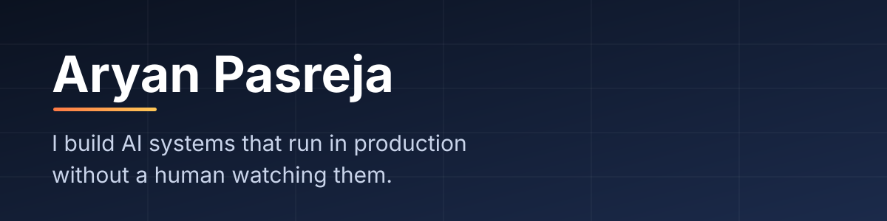

  
  
  

## 👋 Hi, I'm Aryan

AI Engineer on the GTM team at **[Fello](https://hifello.com)**. I own the systems the revenue motion runs on, **end to end: design, build, ship, and the pager when they misbehave.** Sales, marketing, and the data layer underneath both.

Most of my work is private company code, so I write each system up in public instead.

---

## ⭐ Start here: read these two

| | What it is | Why it's worth your five minutes |
|---|---|---|
| **[Revenue OS →](https://github.com/ARAYN7011/revenue-os)** | A daily work list for sales reps. Each morning one screen says what to do today, in order, and why. | The product bet, a layered architecture with an enforced boundary ratchet, and a data dictionary where every fact carries the query that measured it. |
| **[Felix Sells →](https://github.com/ARAYN7011/felix-sells)** | An AI teammate that runs signal-driven outbound over email and SMS. The outreach *is* the demo. | The LLM picks intent; deterministic code gates every send. Frozen evals, shadow-to-enforce rollout, and a privacy wall in the memory. |

Each has a demo video at the top and a founder section and an engineer section underneath.

---

## 📊 What I've shipped

| | |
|---|---|
| 🎙️ **Autonomous voice agent** | Cold-calls real estate hiring managers and books its own meetings. Do-not-call, call windows and disclosure rules are **gates in code**, not prompt instructions. |
| 🔎 **A GTM signal no vendor sells** | Infers real estate **team size** from a name and a company. **117 tests**, **1,534 req/s** at concurrency 100. A later agentic version enriched **1,755 records in 86 minutes**: 1,395 high-confidence, 323 medium, 32 with no answer, **zero pipeline failures**. |
| ✍️ **Multi-channel content platform** | One campaign brief becomes blog, email and ad content, routes through human review, and publishes into the systems of record. |
| 🏆 **30-day sales competition platform** | Ran a **real cohort**: automated bracket tournament, about **3,969 scored entries**, and an AI cold-call practice coach over realtime voice. |

---

## 🧠 How I build

1. **Put the invariants in code, never in the prompt.** Every dial path goes through one audited function. It checks do-not-call, attempt caps, live-call detection and the contact's local call window *before the phone rings*, and writes an audit row for every evaluation, operator overrides included. *A prompt can't guarantee anything, so I don't ask it to.*
2. **Treat prompts as deployment artifacts.** Changes ship only after clearing **59 frozen evaluation cases** (abstention on missing facts, objection reframing, timing clamps, hard compliance refusals), plus a live conversation simulation that caught a regression every unit and integration test passed.
3. **Design for the model being wrong.** Sliding-window health checks instead of consecutive-failure counting. Never retry a billing error. Sentinel values instead of `NULL`, so batch queues drain. A named failure taxonomy, so "success rate is 40%" becomes a ranked list of what to fix next.
4. **Write the postmortem into the repo.** The next engineer inherits what I learned instead of relearning it.
5. **Work like a forward-deployed engineer.** Sit with the people who use the thing; own the outcome, not the ticket.

> In voice, the binding constraint is latency: the inbound personalization webhook has a hard **~1.5 s budget** with no room for an LLM call, so everything known at pickup must be precomputed.

---

## 🛠️ Stack

---

## 🧭 Path

- **Fello** · AI Applied Engineer · Sep 2025 → now. Owns the GTM AI systems above.
- **Monarch Labs** · AI Engineer (freelance) · May → Sep 2025. Built a viral-story-to-newsletter pipeline on n8n. The client reported getting **3–4 hours a day back**. This is where I hit n8n's limits, and why I now port fragile visual workflows into real services.
- **RePut.ai** · Junior Software Developer · Feb → Jun 2025. Hiring-flow automation (Slack, ClickUp, Calendly, DocuSign) and a voice-chat-with-PDFs RAG tool.
- **Vellore Institute of Technology** · B.Tech, Computer Science · 2021 → 2025
- **Salesforce Certified AI Associate**

---

<b>Looking for someone to own an AI system end to end?</b> <a href="mailto:aryanpasreja@gmail.com">Let's talk.</a>

